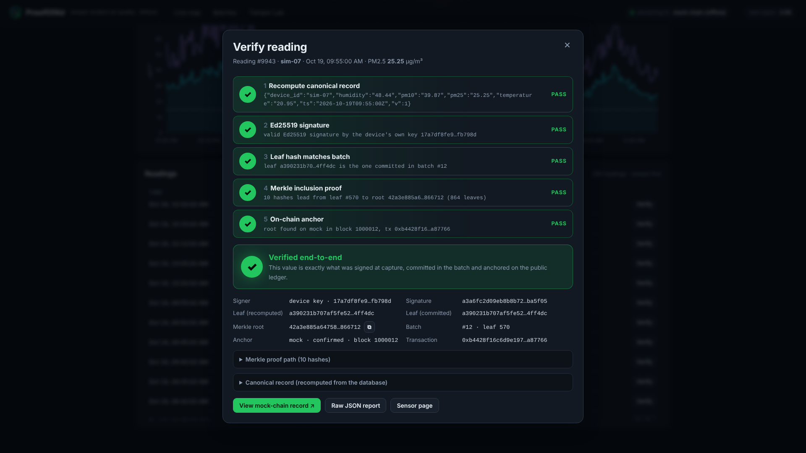
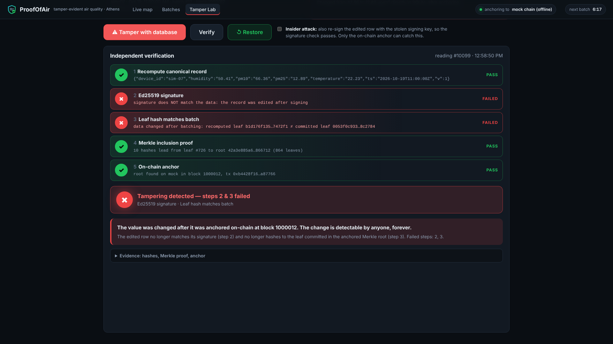

# ProofOfAir

**Tamper-evident air-quality data. Every reading is signed, batched into a Merkle tree and
anchored on a public blockchain, so anyone can prove it was never changed.**

*IEEE ClimateChain Global Hackathon 2026 · Track 4: Climate Data & Environmental Monitoring
(also Track 1: Emissions Transparency)*

> 📸 **Screenshot placeholder:** live map of Athens (`docs/img/map.png`, to be recorded with
> map tiles on)



---

## 1. The problem

Climate policy runs on sensor data: pollution fines, low-emission zones, health warnings and
carbon credits all depend on it. Yet that data usually lives in an ordinary database, where
whoever has write access can change it.

- **Unverifiable data.** A city or company publishes a CSV and everyone else has to take it
  on trust. Nothing shows whether a value was edited after it was measured.
- **Greenwashing.** An emitter with an incentive to look clean can quietly "fix" an
  inconvenient pollution spike.
- **Carbon-credit double counting.** When the measurements behind a credit can't be audited,
  the same reduction can be claimed, sold or reported twice.

## 2. How it works

```
  ① SIGN            ② BATCH            ③ MERKLE ROOT            ④ ANCHOR
 ┌────────┐        ┌────────┐        ┌──────────────┐        ┌───────────────┐
 │reading │─Ed25519│ every N│ leaves │      root    │ 1 tx   │ Polygon Amoy  │
 │ + sig  │───────►│ minutes│───────►│     /    \   │───────►│ or Bitcoin    │
 └────────┘        └────────┘        │   ..    ..   │        │ (OpenTimestamps)
  device or                          └──────────────┘        └───────────────┘
  gateway key
```

1. **Sign.** Each reading is serialized canonically (sorted-key JSON, fixed two-decimal
   values) and signed with **Ed25519**. Simulated sensors and the ESP32 node sign with their
   own device key. Public Sensor.Community readings are signed by the ProofOfAir gateway at
   ingestion.
2. **Batch.** Every few minutes, all new readings are grouped into a batch.
3. **Merkle root.** Each `canonical ‖ signature` becomes a leaf of an RFC 6962-style Merkle
   tree. One 32-byte root commits to every reading in the batch.
4. **Anchor.** The root is published in **one transaction**: the `AnchorRegistry` contract on
   Polygon Amoy, or Bitcoin via OpenTimestamps. A mock backend covers offline development.

**Verify flow.** Click any reading and five checks run, each covering one link in the chain
of evidence:

| # | Check | Question it answers |
|---|---|---|
| 1 | Recompute canonical | What do the database columns say *right now*? |
| 2 | Ed25519 signature | Did the sensor/gateway sign exactly these values? |
| 3 | Leaf hash | Are these the same bytes that went into the batch? |
| 4 | Merkle proof | Is that leaf really part of the batch root? |
| 5 | On-chain anchor | Is that root on the public ledger? |

Verification recomputes everything from the **editable** columns, never from a stored copy.
Change one number in SQLite and it turns red at the step that broke.
More detail: [`docs/architecture.md`](docs/architecture.md).

## 3. Demo



> 🎞️ **GIF placeholder:** `docs/img/tamper.gif`, Tamper Lab "hide the spike" → red → Restore
> → green
>
> ▶️ **Video:** *link to the 4-minute demo (YouTube, unlisted)*

The **Tamper Lab** (`/tamper.html`) lets you play the malicious database admin:

- **Tamper with database** multiplies an anchored PM2.5 value by 0.3, *without* re-signing.
  Steps 2 and 3 fail.
- **Insider attack** also re-signs the edited row with the stolen key. The signature now
  passes, but step 3 still fails, because the leaf no longer matches the root anchored on
  chain.
- **Restore** puts the true value back, and all five checks turn green again.

A CLI version for the terminal: `python scripts/tamper.py` (`--resign`, `--restore ID`).

## 4. Quick start

Requires Python 3.11+ and `make`. No wallet, API key or Docker needed.

```bash
git clone <this repo> && cd <repo>
make setup keys seed run
# open http://localhost:8000
```

- `make setup` creates `.venv`, installs the dependencies and copies `.env.example` to `.env`.
- `make keys` creates the gateway key and 12 simulated device keys in `data/keys/` (mode 600).
- `make seed` backfills 3 days: real Sensor.Community sensors around Athens when the network
  allows, plus the 12 simulated sensors. It also closes and anchors the historical batches.
- `make run` starts the API and dashboard. The scheduler ingests every 5 min and batches
  every 10 min.

It runs fully offline with `ANCHOR_BACKEND=mock` (the default). If Sensor.Community can't be
reached, the map simply shows the simulated sensors, which are labelled as such.

Other targets: `make demo` (seed if needed, close a batch now, print demo URLs),
`make test`, `make lint`, `make deploy`, `make clean`.

### API

| Method | Path | |
|---|---|---|
| GET | `/api/health` | backend, counts, next batch ETA, last anchor |
| GET | `/api/devices` | devices + latest reading + verified ratio (24 h) |
| GET | `/api/devices/{id}/readings?hours=24` | time series |
| GET | `/api/readings/{id}` | one reading, canonical bytes, signature |
| GET | `/api/readings/{id}/verify` | the five-check report |
| GET | `/api/batches`, `/api/batches/{id}` | batches with anchor status and explorer URL |
| POST | `/api/ingest/device` | signed reading from an ESP32 (signature checked first) |
| POST | `/api/demo/tamper/{id}`, `/api/demo/restore/{id}`, `/api/demo/batch-now` | `DEMO_MODE` only |

Interactive docs: http://localhost:8000/docs

## 5. Anchoring on Polygon Amoy (testnet)

1. Create a **new, testnet-only** wallet (for example a fresh MetaMask account). **Never use a
   wallet that holds real funds.**
2. Get free test POL from a faucet such as <https://faucet.polygon.technology>.
3. Put the key in `.env`: `POLYGON_PRIVATE_KEY=0x…` (`.env` is gitignored).
4. `make deploy`. This compiles `contracts/AnchorRegistry.sol` with solc 0.8.24 via
   py-solc-x, deploys it, writes the ABI and prints the address.
5. In `.env`, set `ANCHOR_CONTRACT_ADDRESS=0x…` and `ANCHOR_BACKEND=polygon`, then restart
   `make run`.

Each batch now produces a Polygonscan link (`https://amoy.polygonscan.com/tx/…`), and check 5
reads `roots(batchId)` back from the chain. If the RPC is down, the batch is marked `failed`
and retried every 30 minutes. Batch ids are the on-chain keys, so **after resetting the
database (`make clean`), deploy a fresh contract.**

**Alternative, no wallet:** `ANCHOR_BACKEND=ots` stamps each root into Bitcoin through the
public OpenTimestamps calendars. Batches stay `pending` until Bitcoin confirms them, which
usually takes a few hours. An hourly job runs `ots upgrade`, and the `.ots` proof can be
downloaded from `/api/batches/{id}/ots` and checked at <https://opentimestamps.org>.

## 6. Cost and scale

There is **one transaction per batch, whatever the number of readings**, and proofs grow only
with log₂(n).

Estimate for anchoring a whole city every 10 minutes (144 tx/day) on **Polygon PoS mainnet**:

| Assumption | Value |
|---|---|
| Gas per `anchor()` call | **45,990** (measured on a local EVM: 21k base + 22k new storage slot + event + calldata) |
| Gas price | 30–100 gwei (typical Polygon PoS range) |
| POL price | $0.25–$0.50 (assumption; check the current price) |
| Cost per tx | 0.0014–0.0046 POL ≈ $0.0003–$0.0023 |
| **Per day (144 tx)** | **≈ 0.2–0.66 POL ≈ $0.05–$0.33** |
| **Per year** | **≈ $18–$120** |

A city of 1,000 sensors reporting every minute gives 10,000 readings per batch, so about
**well under $0.000001 per reading**, with 14-hash (448-byte) proofs. On Amoy testnet it is free.
With OpenTimestamps it is free too (the calendars aggregate many roots into one Bitcoin tx),
at the cost of hours of latency. Ethereum L1 would cost about 100–1000× more per tx, still
still only tens to hundreds of dollars a day, because batching spreads the cost over every reading. Gas prices and the POL price move a lot, so treat the dollar figures as an order of
magnitude; the gas used per anchor is fixed by the contract.

## 7. Security model and limitations

- **It proves integrity after capture, not sensor accuracy.** A miscalibrated or manipulated
  sensor produces signed, anchored, *wrong* data. ProofOfAir guarantees that nobody changed
  the numbers later. It doesn't guarantee they were right.
- **Gateway-signed vs device-signed.** Public Sensor.Community sensors don't sign on the
  device, so ProofOfAir signs their readings with a gateway key **at the moment of
  ingestion**. Protection starts there. Simulated sensors and the ESP32 node sign with their
  own keys, so protection starts at the sensor.
- **Key custody.** The server holds the gateway key and, for the demo, the simulated device
  keys (`data/keys/`, mode 600, gitignored). A key holder can forge *new* readings, but they
  still can't alter readings that are already anchored: the Tamper Lab's insider mode shows
  that.
- **Testnet only.** Amoy is a test network with no economic security, and its history could
  be reset. Production would use Polygon PoS mainnet, an L2, or OpenTimestamps/Bitcoin.
- **Anchoring latency.** Readings are only fully verifiable once their batch is anchored
  (≤ `BATCH_INTERVAL_SEC`, or hours for OTS). Until then steps 3–5 show "pending".
- **Deletion and withholding.** Anchoring proves that published readings are unchanged. A
  reading that is never ingested can't be proven missing. The batch leaf count
  (`n_leaves`) does make deleting a batched reading detectable.
- **The mock backend is not tamper-proof.** It is a local JSON file for offline development.
- **Demo endpoints.** `DEMO_MODE=true` exposes the tamper/restore endpoints. Turn it off for
  anything public.

## 8. Track alignment and judging criteria

- **Track 4, Climate Data & Environmental Monitoring:** real air-quality monitoring
  (Sensor.Community, Athens) with verifiable data integrity.
- **Track 1, Emissions Transparency:** the same pipeline makes emissions-related
  measurements (industrial zones, ports) auditable by regulators and the public.

| Criterion | ProofOfAir |
|---|---|
| Climate Impact | Makes the data behind pollution enforcement, health alerts and carbon accounting trustworthy and auditable. |
| Innovation & Creativity | Combines per-reading signatures, Merkle batching and public anchoring, with a live Tamper Lab that *shows* tampering being caught. |
| Technical Execution | Ed25519, RFC 6962-style Merkle tree, three anchor backends, 150+ tests, and it runs offline out of the box. |
| Practical Usefulness | One cheap transaction per batch, works with existing open sensor networks and $15 ESP32 nodes. |
| Presentation & Storytelling | The "hide the pollution spike" demo: green → red → green in one click. |

## 9. Roadmap

- **Device-signed hardware:** ship the ESP32 node ([`firmware/esp32_node/`](firmware/esp32_node))
  with a secure element so keys can't be extracted.
- **Multi-organization gateways:** several independent gateways co-sign or cross-anchor,
  so no single operator has to be trusted.
- **Carbon-registry integration:** link credits to anchored monitoring data to prevent
  double counting.
- **EU open-data APIs:** ingest EEA air-quality data and publish verifiable datasets on the
  EU open-data portals.
- Public verifier: a standalone page or CLI that verifies a reading with nothing but the
  JSON proof and a public RPC.

## 10. Built with AI assistance

This project was developed with **Claude Code** (Anthropic's AI coding assistant), working
from a written specification. The author reviewed, ran and tested the code, and is
responsible for the design decisions and the submission. The AI assistance is disclosed
here in line with the hackathon's rules on transparency.

## 11. Data credits

- Air-quality data: **[Sensor.Community](https://sensor.community)** contributors, open data
  (Open Database License). Thanks to the citizen scientists who run these sensors.
- Map tiles and data: © **[OpenStreetMap](https://www.openstreetmap.org/copyright)**
  contributors.
- Libraries: FastAPI, PyNaCl, web3.py, OpenTimestamps, APScheduler, Leaflet, Chart.js.
- Simulated sensors are synthetic data generated by `proofofair/ingest/simulator.py` and are
  labelled "simulated" everywhere in the UI.

## 12. Project layout

```
proofofair/      canonical · crypto · merkle · db · batcher · verify · scheduler · api
  ingest/        sensor_community · simulator · device_endpoint
  anchor/        base · mock · polygon · ots
web/             index (map) · sensor · batches · tamper (Tamper Lab) · css · js
contracts/       AnchorRegistry.sol + ABI
scripts/         gen_keys · seed_history · run_demo · tamper · deploy_contract
firmware/        optional ESP32 node (Ed25519 on device)
docs/            architecture · video_script
tests/           pytest suite, no network needed
```

## 13. License

[MIT](LICENSE) © 2026 Nikos Georgiopoulos
