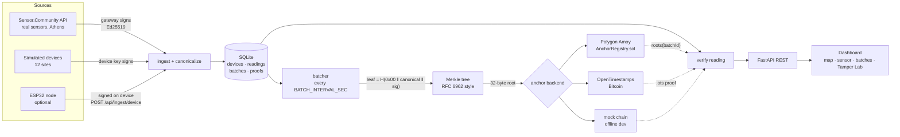

# ProofOfAir architecture

## Data flow

1. **Ingest.** Every `INGEST_INTERVAL_SEC` the scheduler pulls the Sensor.Community area
   endpoint for Athens and ticks the simulator. ESP32 nodes push signed readings whenever
   they like.
2. **Canonicalize and sign.** A reading becomes canonical bytes (`canonical.py`): sorted-key
   JSON, no whitespace, values as two-decimal strings, `"v":1`. Those bytes are signed with
   Ed25519, by the device's own key (simulator, ESP32) or by the gateway key
   (Sensor.Community, whose public sensors cannot sign). Readings are deduplicated on
   `(device_id, ts)`.
3. **Batch.** Every `BATCH_INTERVAL_SEC`, `close_batch()` takes every unbatched reading,
   builds a Merkle tree over `canonical ‖ signature` leaves, and stores the root, each
   reading's leaf hash and its inclusion proof.
4. **Anchor.** The 32-byte root is published once per batch. Polygon stores it in
   `roots[batchId]` (write-once, owner-only). OpenTimestamps commits it to Bitcoin through
   the public calendars. The mock backend writes a JSON file so everything works offline.
   Failed anchors are retried every 30 minutes, and pending OTS proofs are upgraded hourly.
5. **Verify.** `verify_reading()` recomputes everything from the editable database columns.

## The five checks

| # | Check | Links | Catches |
|---|---|---|---|
| 1 | Recompute canonical | DB columns → bytes | malformed rows |
| 2 | Ed25519 signature | bytes → signer key | any edit made without the key |
| 3 | Leaf hash | bytes + sig → committed leaf | any edit after batching, **even with the key** |
| 4 | Merkle proof | committed leaf → batch root | corrupted proofs or leaves |
| 5 | On-chain anchor | batch root → public ledger | a rewritten batch (root recomputed in the DB) |

Each check covers exactly one link, so the first red step shows *where* the chain of
evidence broke. Some examples:

- `UPDATE readings SET pm25 = pm25 * 0.3` → steps 2 and 3 fail.
- The same edit plus a re-signature with a stolen key → only step 3 fails.
- An attacker who also recomputes the leaves, the proofs and the batch root in the database
  → steps 1–4 pass and step 5 fails, because the public ledger still holds the original
  root. That is the point of anchoring: rewriting history means rewriting the blockchain.

All three cases are covered in `tests/test_verify_tamper.py`.

## Merkle tree details

- `leaf_hash(d) = SHA-256(0x00 ‖ d)` and `node_hash(l, r) = SHA-256(0x01 ‖ l ‖ r)`. The
  domain separation stops an inner node from being passed off as a leaf.
- With an odd number of nodes, the last node is *promoted*, not duplicated. That gives the
  same root as RFC 6962's recursive definition (tested for 1–64 and 1,000 leaves) and avoids
  Bitcoin's duplicate-leaf ambiguity (CVE-2012-2459).
- A proof is a list of `{pos: "L"|"R", hash}` siblings, about `log2(n)` × 32 bytes: 14 hashes
  for a 10,000-reading batch.

## Modules

| File | Role |
|---|---|
| `proofofair/canonical.py` | exact bytes that are signed |
| `proofofair/crypto.py` | Ed25519 keys (hex seed files, mode 600), sign, verify |
| `proofofair/merkle.py` | tree, proofs, proof verification |
| `proofofair/db.py` | schema, inserts, demo tamper/restore helpers |
| `proofofair/ingest/` | Sensor.Community, simulator, ESP32 endpoint helpers |
| `proofofair/batcher.py` | close batch, retry failed anchors, refresh pending ones |
| `proofofair/anchor/` | `mock`, `polygon` (web3.py), `ots` (OpenTimestamps CLI) |
| `proofofair/verify.py` | the five checks |
| `proofofair/scheduler.py` | APScheduler jobs, started from the FastAPI lifespan |
| `proofofair/api.py` | REST API + static dashboard |
| `contracts/AnchorRegistry.sol` | write-once root registry |

## Trust boundaries

- **Device-signed** (simulator, ESP32): integrity is protected from the sensor onwards.
- **Gateway-signed** (Sensor.Community): integrity is protected from ingestion onwards.
  Whatever happened before the gateway saw the value is outside what ProofOfAir can prove.
- **Anchor**: a Polygon root is as tamper-proof as the chain. Amoy is a testnet, so its
  history could in principle be reset; production would use Polygon PoS mainnet or an L2.
  An OTS root is as strong as Bitcoin once it is confirmed.
- **Key custody**: the server holds the gateway key and, for the demo, the simulated device
  keys. The Tamper Lab's "insider" mode uses them to show that even a key holder cannot
  rewrite anchored history.
